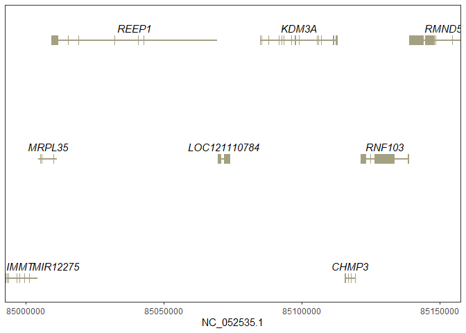
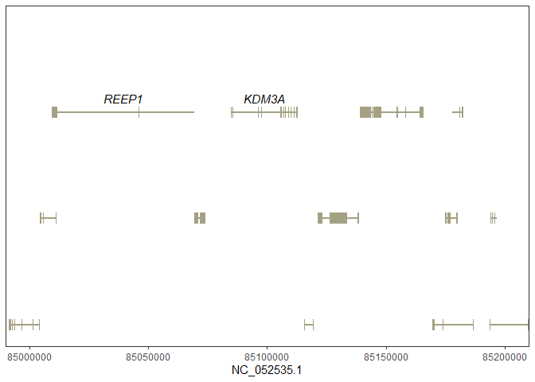

GRCg7br
================

`grcg7br` is a personal R package to annotate and visualize genes of
chicken genome
[bGalGal1.mat.broiler.GRCg7b](https://www.ncbi.nlm.nih.gov/datasets/genome/GCF_016699485.2/).

## Installation

You can use `devtools`:

``` r
install.packages("devtools")
devtools::install_github("ymat2/grcg7br")
```

Alternatively, you can use `pak`:

``` r
install.packages("pak")
pak::pkg_install("ymat2/grcg7br")
```

## Usage

grcg7br provides 2 functions: `annotate()` and `gggenes()`.

### `annotate()`

This function takes a data frame containing chromosome, start, and end
columns—such as output files from VCFtools—and annotates genes from
GRCg7b assembly that overlap those regions. Internally, it uses
[GenomicRanges](https://github.com/Bioconductor/GenomicRanges).

Example:

| CHROM       | BIN_START |   BIN_END |   FST |
|:------------|----------:|----------:|------:|
| NC_052532.1 |  38960001 |  38980000 | 0.001 |
| NC_052532.1 |  59440001 |  59460000 | 0.003 |
| NC_052532.1 | 164900001 | 164920000 | 0.014 |
| NC_052533.1 |  30340001 |  30360000 | 0.002 |
| NC_052535.1 |  85000001 |  85020000 | 0.009 |

``` r
fst_genes = fst |> grcg7br::annotate(seqname = "CHROM", start = "BIN_START", end = "BIN_END")
```

| CHROM       | BIN_START |   BIN_END |   FST | gene         |
|:------------|----------:|----------:|------:|:-------------|
| NC_052532.1 |  38960001 |  38980000 | 0.001 | NAV3         |
| NC_052532.1 |  59440001 |  59460000 | 0.003 | AMN1         |
| NC_052532.1 |  59440001 |  59460000 | 0.003 | ETFBKMT      |
| NC_052532.1 | 164900001 | 164920000 | 0.014 | NA           |
| NC_052533.1 |  30340001 |  30360000 | 0.002 | LOC112531701 |
| NC_052535.1 |  85000001 |  85020000 | 0.009 | IMMT         |
| NC_052535.1 |  85000001 |  85020000 | 0.009 | MRPL35       |
| NC_052535.1 |  85000001 |  85020000 | 0.009 | REEP1        |
| NC_052535.1 |  85000001 |  85020000 | 0.009 | MIR12275     |

### `gggenes()`

This function visualizes gene structures within a specific genomic range
using `ggplot2` ecosystem.

Example:

``` r
grcg7br::gggenes(
  chrom = "NC_052535.1",
  from = 85000001,
  to = 85150001,
  color = "#A4A082",
  nrow = 3
)
```

<!-- -->

You can use a vecter of gene names to show a part of genes in the
region:

``` r
grcg7br::gggenes(
  chrom = "NC_052535.1",
  from = 85000001,
  to = 85150001,
  color = "#A4A082",
  nrow = 3,
  label = c("REEP1", "KDM3A")
)
```

<!-- -->
